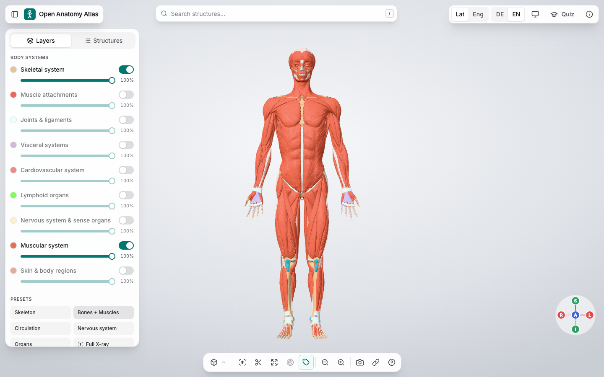
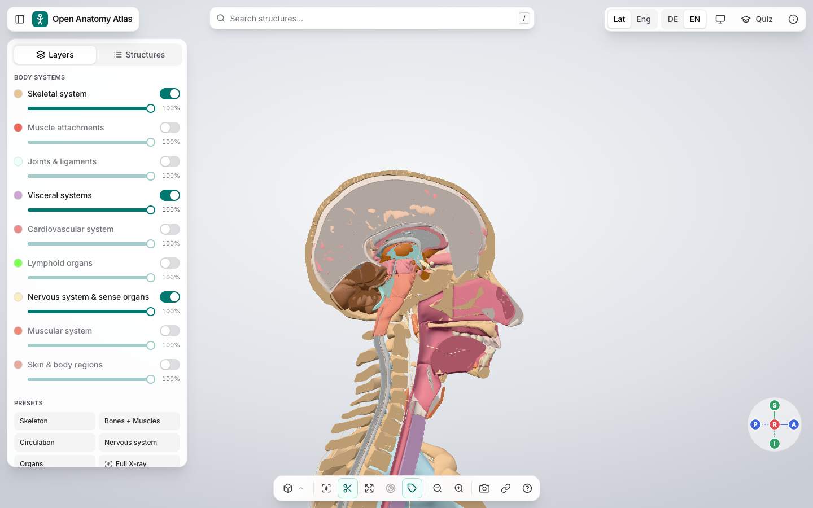

# learnanatomy.org

**DE** — Ein freier, gemeinnütziger 3D-Anatomieatlas im Browser für Medizinstudierende. Knochen, Muskeln, Organe,
Gefäße und Nerven lassen sich ein- und ausblenden, durchsuchen, schneiden, auseinanderziehen und im Quiz lernen.
Keine Anmeldung, kein Tracking, kein Server: eine statische Website. Anatomische Namen auf Latein und Englisch
(Terminologia Anatomica), Oberfläche auf Deutsch und Englisch. Nur für die Lehre, nicht für die Diagnostik.

**EN** — A free, nonprofit 3D anatomy atlas in the browser for medical students. Show and hide bones, muscles, organs,
vessels and nerves; search, cut, explode and quiz yourself. No accounts, no tracking, no server: a static website.
Anatomical names in Latin and English (Terminologia Anatomica), UI in German and English. Educational use only, not
for diagnosis.




**Live: <https://learnanatomy.org>**

Data: [Z-Anatomy](https://github.com/Z-Anatomy/Models-of-human-anatomy) (CC BY-SA 4.0), derived from BodyParts3D.
Full attribution in [ATTRIBUTION.md](ATTRIBUTION.md).

---

## Features

- 9 body systems as layers (skeleton, muscle attachments, joints, viscera, cardiovascular, lymphoid, nervous,
  muscles, skin/regions) with visibility, opacity and X-ray; about 3 900 structures, 520 groups, 1 070 landmarks
- search across Latin, English and synonyms; structure tree; info panel with Wikipedia definitions (marked
  "unreviewed" until checked by a human)
- isolate / isolate with context, sagittal / coronal / transverse cutting planes, exploded view, standard views
- quiz: locate (click in 3D), identify (multiple choice), name it (typed, typo tolerant), spaced repetition
- shareable links: the URL encodes the view (layers, selection, planes, camera, …)

## Quick start

Requirements: Node.js ≥ 22, git, [Blender](https://www.blender.org/download/) 4.5 (only for the asset pipeline).

```bash
npm install
npm run dev            # http://localhost:5173 — without built assets the dev server falls back to mock data
```

### 1. Get the Z-Anatomy data

Download `Z-Anatomy.zip` (or the unzipped `Startup.blend`) from
<https://github.com/Z-Anatomy/Models-of-human-anatomy> into `data/raw/`. Optional: `TA2.csv` from the same
repository into `data/raw/ta2/` (adds Terminologia Anatomica ids). `data/raw/` is never committed.

### 2. Blender

Copy `.env.example` to `.env.local` and set `BLENDER_PATH`, e.g.
`/Applications/Blender.app/Contents/MacOS/Blender` (macOS) or
`C:\Program Files\Blender Foundation\Blender 4.5\blender.exe` (Windows). Without it the pipeline tries `blender` on
`PATH` and the default install locations. Blender runs headless (`-b -Y`); the `.blend` is never modified.

### 3. Build the assets

```bash
npm run assets:build     # inventory → export (Blender, ~15 min) → process → manifest → validate
npm run assets:validate
npm run assets:manifest  # data files only (after a config change or a definition review; no Blender)
```

Output goes to `public/models/` (gitignored, ~38 MB, no file over 20 MB). The build fails on any orientation or
left/right error. Reports: `data/inventory/PIPELINE_REPORT.md`. Single systems: `ASSET_SYSTEMS=skeletal npm run assets:build`.

### 4. Develop and test

```bash
npm run dev
npm run typecheck && npm run lint
npm test               # unit + component tests (Vitest)
npm run test:e2e       # Playwright, desktop 1440×900 and phone 390×844 (software WebGL, slow but GPU-free)
npm run build          # → dist/
```

QA specs on the real assets need a GPU and are opt-in (macOS/Linux shell syntax):

```bash
QA_GPU=1 npx playwright test tests/e2e/qa-functional.spec.ts tests/e2e/qa-anatomy.spec.ts --workers=2
```

Useful URL flags: `?data=mock` (small mock scene), `?testHooks=1` (exposes `window.__atlas` for tests),
`?stats=1` (fps / draw calls overlay).

### 5. Deploy (Cloudflare Pages)

Live: <https://learnanatomy.org> (custom domain of the Pages project; also <https://open-anatomy-atlas.pages.dev>)

```bash
npm run assets:build          # public/models/ must exist; it is copied into dist/
npm run seo:thumbs            # page images + social cards → public/thumbs/ (GPU, ~35 min; only missing ones)
npm run build                 # app + ~6 000 static structure pages, sitemap.xml, 404.html
npx wrangler login            # once per machine
npx wrangler pages deploy dist --project-name open-anatomy-atlas --branch main
```

The Pages project already exists. Creating it anew with wrangler ≥ 4.15x needs `--force`, because newer wrangler
otherwise routes `pages` commands to Workers:
`npx wrangler pages project create open-anatomy-atlas --production-branch main --force`.

Donations go through a Stripe Payment Link: `DONATION_URL` in `src/donation.ts` is the only place it is set. In the
Stripe dashboard, the link's "After payment" setting redirects to `https://learnanatomy.org/thanks`.

`public/_headers` sets cache headers. The site is fully static (no functions, no cookies). The build also ships
`ATTRIBUTION.md`, `LICENSE` and `assets.LICENSE` as `/licenses/*.txt`; the credits page links them.

### 6. Search engines

`npm run build` writes a static page for every structure in English and German (`/en/femur`, `/de/femur`), an
index per system, `sitemap.xml` and `404.html` (details: [ARCHITECTURE.md §14](ARCHITECTURE.md)). Skip
`seo:thumbs` and the pages are built without images. `npm run seo:thumbs -- --only femur,heart --force`
re-renders single pages.

One-time setup in the Cloudflare and Google dashboards (not in the code):

1. **www**: Workers & Pages → `open-anatomy-atlas` → Custom domains → add `www.learnanatomy.org`. Then
   Rules → Redirect Rules → template "Redirect from WWW to root" (301, keep the query string).
2. **Google Search Console**: add a *Domain* property `learnanatomy.org`, verify with the DNS TXT record
   (Cloudflare can add it automatically), then Sitemaps → `https://learnanatomy.org/sitemap.xml`.
3. **Bing Webmaster Tools**: "Import from Google Search Console".

## Project structure

```
pipeline/          asset pipeline: blender/ (inventory.py, export.py, run.mjs), process.mjs, manifest.mjs,
                   validate.mjs, review-definition.mjs, lib/, config/ (systems, overrides, definition reviews,
                   non-commercial list)
src/contract/      shared types: data files, store, viewer commands
src/state/         zustand store, visibility rules, data sources
src/viewer/        three.js / react-three-fiber viewer (BatchedMesh per chunk, picking, clipping, labels)
src/ui/            layout, panels, tree, search, info panel, dialogs, URL state
src/quiz/          quiz generation, Leitner boxes, quiz panel
src/i18n/          DE / EN UI strings
src/mocks/         mock data for development and tests
tests/             unit setup, Playwright specs
data/inventory/    inventory of the .blend and pipeline reports (committed); data/raw/ is not
ARCHITECTURE.md    design, data model, decisions and deviations
```

## Contributing

Anatomy reviewers are especially welcome: definitions come from Wikipedia and are shown as "unreviewed" until a
person has checked them (`npm run review:definition`). See [CONTRIBUTING.md](CONTRIBUTING.md). Left/right or naming
errors in the source data are fixed only through reviewed entries in `pipeline/config/overrides.json`. Problems found
in the upstream data are collected in [docs/UPSTREAM_ISSUES.md](docs/UPSTREAM_ISSUES.md).

## Licenses

- **Code**: MIT — [LICENSE](LICENSE)
- **3D models and extracted metadata**: CC BY-SA 4.0 — [assets.LICENSE](assets.LICENSE), from Z-Anatomy
  (CC BY-SA 4.0), BodyParts3D (CC BY-SA 2.1 JP)
- **Definitions**: Wikipedia, CC BY-SA 3.0, with a source link per definition
- **Non-commercial parts**: the inner ear (cochlea, vestibule; University of Dundee, CC BY-NC-SA 4.0) and the kidney
  models (Lissie Cowley, CC BY-NC 4.0) are flagged `nonCommercial: true` and listed in [ATTRIBUTION.md](ATTRIBUTION.md)

The screenshots in this README show CC BY-SA 4.0 content from Z-Anatomy.
